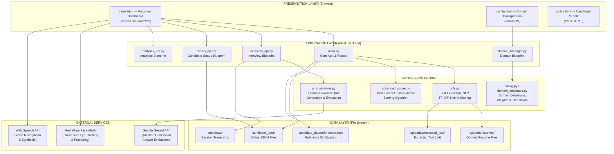
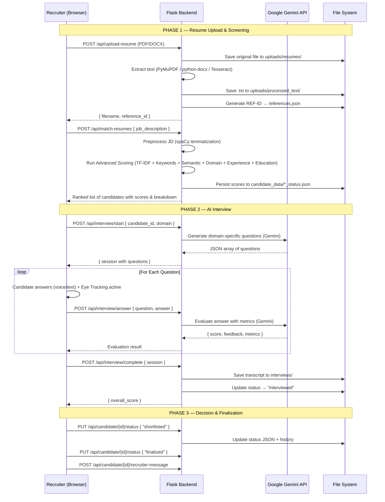
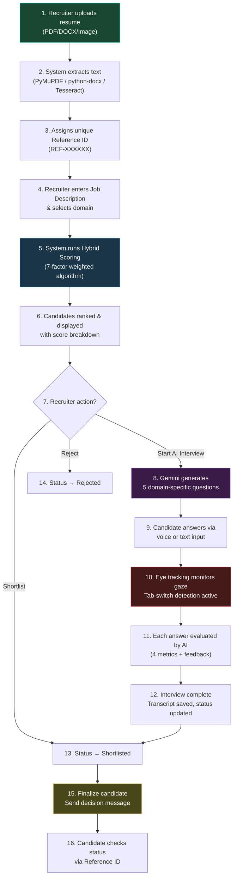

# NeuralHire — AI-Powered Recruitment Automation System
### Final Project Review Document

---

## 1. System Architecture

The system follows a **monolithic three-tier architecture** with a Python Flask backend serving a React-based single-page application (SPA) frontend. All data is persisted using the local filesystem (JSON files).

### 1.1 Architecture Diagram



### 1.2 Data Flow Diagram



---

## 2. Technologies Used

| Layer | Technology | Purpose |
|-------|-----------|---------|
| **Frontend** | HTML5, CSS3, JavaScript (ES6+) | Core web technologies |
| | React 18 (via CDN) | Component-based SPA UI |
| | TailwindCSS (via CDN) | Utility-first responsive styling |
| | Framer Motion | Page transitions & animations |
| | Font Awesome | Icon library |
| | Google Fonts (Inter, JetBrains Mono) | Typography |
| **Backend** | Python 3.x | Server-side language |
| | Flask | Lightweight web framework |
| | Flask-CORS | Cross-Origin Resource Sharing |
| | Flask Blueprints | Modular route organization |
| **NLP & ML** | spaCy (en_core_web_sm) | Tokenization, lemmatization, semantic similarity |
| | scikit-learn (TF-IDF) | Term frequency vectorization & cosine similarity |
| | NumPy, Pandas | Numerical computation & data handling |
| **AI / GenAI** | Google Gemini API | Interview question generation & answer evaluation |
| | (gemini-flash-latest, gemini-1.5-flash, gemini-pro) | Model fallback chain |
| **Document Parsing** | PyMuPDF (fitz) | PDF text extraction |
| | python-docx | DOCX text extraction |
| | Pillow + Tesseract OCR | Image-based resume text extraction |
| **Anti-Cheat / Proctoring** | MediaPipe Face Mesh (client-side) | Real-time eye/gaze tracking via webcam |
| | Web Speech API | Voice-to-text for interview answers |
| | Visibility API | Tab-switching detection |
| **Data Storage** | JSON flat files | Candidate status, interview sessions, references |
| **Deployment** | Gunicorn | Production WSGI server |
| | Procfile | Heroku/Railway deployment |

---

## 3. Modules Description

### Module 1: Resume Upload & Text Extraction
**Files:** [main.py](file:///d:/updated%20res/res/main.py) → [utils.py](file:///d:/updated%20res/res/utils.py)

- Accepts PDF, DOCX, TXT, and image-based resumes via `/api/upload-resume`.
- Extracts raw text using PyMuPDF (for PDFs), python-docx (for DOCX), and Tesseract OCR (for images).
- Saves processed text to `uploads/processed_text/` for downstream analysis.
- Generates a unique `REF-ID` (e.g., `REF-A3X9K2`) for each candidate, stored in `references.json`.

---

### Module 2: Hybrid Resume Scoring Engine
**Files:** [utils.py](file:///d:/updated%20res/res/utils.py) → [advanced_scorer.py](file:///d:/updated%20res/res/advanced_scorer.py) → [config.py](file:///d:/updated%20res/res/config.py)

The core intelligence of the system. Implements a **multi-factor weighted scoring algorithm** with 7 components:

| Component | Weight | Method |
|-----------|--------|--------|
| TF-IDF Cosine Similarity | 15% | scikit-learn TfidfVectorizer (unigrams to trigrams) |
| Keyword Matching | 25% | Domain-specific keyword extraction with F1-score |
| Semantic Similarity | 15% | spaCy word vector similarity |
| Experience Matching | 10% | Regex-based year extraction + proximity scoring |
| Domain Classification | 10% | Keyword density across 10 preconfigured domains |
| Education Level | 5% | Hierarchical education detection (PhD → Associate) |
| Role/Title Match | 20% | Header-prioritized exact/partial title matching |

**Candidate Classification Thresholds (0–100 scale):**
- ≥ 75: Excellent Fit — Highly Recommended
- ≥ 60: Good Fit — Recommended
- ≥ 40: Potential Fit — Consider
- ≥ 20: Marginal Fit — Review Carefully
- < 20: Auto Reject

---

### Module 3: Domain Management System
**Files:** [domain_manager.py](file:///d:/updated%20res/res/domain_manager.py) → [domain_templates.py](file:///d:/updated%20res/res/domain_templates.py) → [config.py](file:///d:/updated%20res/res/config.py)

- **10 built-in domains:** Software Engineering, Data Science, DevOps & Cloud, Frontend, Backend, Mobile, Cybersecurity, UI/UX Design, Product Management, General IT.
- Each domain carries its own keyword dictionary, required skills, and job description templates.
- Recruiters can **create, edit, and delete custom domains** via the `/config` page, stored separately in `custom_domains.json`.
- Custom domains are hot-merged into the scoring engine at runtime without server restart.

---

### Module 4: AI Interviewer (Gemini-Powered)
**Files:** [ai_interviewer.py](file:///d:/updated%20res/res/ai_interviewer.py) → [interview_api.py](file:///d:/updated%20res/res/interview_api.py)

- Generates **5 personalized interview questions** per candidate using Google Gemini, tailored to:
  - The candidate's resume content
  - The job description
  - The detected domain
- Questions span Technical, Behavioral, and Problem-Solving categories with varying difficulty.
- **Answer Evaluation** returns 4 metrics (Technical Accuracy, Communication Clarity, Problem Solving, Cultural Fit) on a 1–10 scale, plus actionable feedback.
- **3-tier fallback chain:**
  1. `gemini-flash-latest` → `gemini-1.5-flash` → `gemini-pro`
  2. If all AI models fail → spaCy-based semantic similarity scoring
  3. If spaCy fails → absolute fallback score of 3/10
- Interview sessions are saved as JSON transcripts to `interviews/` directory.

---

### Module 5: Anti-Cheat Proctoring System
**File:** [index.html](file:///d:/updated%20res/res/templates/index.html) (Client-Side)

Implements **three layers of proctoring** entirely in the browser:

1. **Eye & Gaze Tracking (MediaPipe Face Mesh)**
   - Loads the 468-point facial landmark model via CDN.
   - Calculates head yaw (left/right) and pitch (up/down) using nose-to-edge ratios.
   - If the candidate looks away for > 1.5 seconds, triggers a proctor warning.
   - Draws a live face mesh overlay on a webcam canvas with eye connectors and a nose tracking dot.

2. **Tab-Switch Detection (Visibility API)**
   - Listens for `document.visibilitychange` events.
   - If the candidate switches tabs during the interview, an immediate alert is triggered.

3. **Face Presence Detection**
   - If no face is detected in the camera frame for > 1.5 seconds (candidate leaves the seat), a proctor warning fires.

All violations increment a `proctorWarnings` counter displayed prominently in the interview UI.

---

### Module 6: Candidate Status & Workflow Management
**File:** [status_api.py](file:///d:/updated%20res/res/status_api.py)

Full lifecycle tracking with the pipeline:

```
new → reviewed → interviewed → shortlisted → finalized → hired
                                            → rejected
                                            → on_hold
```

Features:
- **Status transitions** with complete audit history (who, when, from/to).
- **Recruiter notes** (add, delete, view) attached to each candidate.
- **Tags** for flexible categorization.
- **Bulk operations** — shortlist or reject multiple candidates at once.
- **Search & filter** by status, tags, or candidate name.
- **Recruiter decision messages** sent to candidates after interview.
- **Reference ID lookup** for candidate-facing portal access.

---

### Module 7: Analytics Dashboard
**File:** [analytics_api.py](file:///d:/updated%20res/res/analytics_api.py)

Aggregates KPIs from all interview sessions:
- Total candidates in pipeline
- Total interviews conducted
- Average technical score
- Pass rate (≥ 7/10 threshold)
- Domain distribution breakdown
- Score distribution (low / mid / high buckets)

---

### Module 8: Recruiter Dashboard UI
**File:** [index.html](file:///d:/updated%20res/res/templates/index.html)

A **premium, dark-themed React SPA** featuring:
- Resume upload with drag-and-drop
- Job description input with domain auto-detection dropdown
- Real-time candidate grid with score-based color coding
- Candidate detail modal with resume preview, score breakdown, and status actions
- AI Interview modal with voice input, live webcam proctoring feed, and question-by-question flow
- Interview results transcript viewer with per-question AI feedback
- Bulk candidate operations toolbar
- Domain management modal (CRUD)

---

## 4. Methodology / Working

### Step-by-Step System Workflow



### Detailed Data Flow

1. **Resume Intake**: Recruiter uploads a resume file. The backend detects the file type and extracts raw text using the appropriate parser. The text is saved alongside the original file.

2. **Scoring**: When the recruiter submits a job description, the system preprocesses both JD and all resume texts using spaCy (lemmatization, stopword removal). It then computes 7 independent scores per resume, applies configurable weights, and produces a final percentage score (0–100).

3. **AI Interview**: The recruiter initiates an interview for a specific candidate. The system sends the candidate's resume summary and the JD to Google Gemini, which generates tailored questions. The candidate answers each question (via typing or voice dictation), and each answer is evaluated in real-time by Gemini, returning structured metrics and feedback.

4. **Proctoring**: During the interview, the browser loads MediaPipe Face Mesh to continuously analyze the webcam feed. The system calculates head pose angles from facial landmarks. Deviations beyond threshold values trigger visual warnings and increment a counter visible to both the candidate and the recruiter.

5. **Decision**: After reviewing scores and interview transcripts, the recruiter can shortlist, reject, or finalize candidates. A decision message can be attached and will be visible to the candidate via their Reference ID.

---

## 5. Conclusion

### Summary
NeuralHire is a **complete, end-to-end AI-powered recruitment automation system** that covers every stage of the hiring pipeline — from resume ingestion and intelligent scoring, through AI-conducted interviews with real-time proctoring, to final candidate disposition. The system demonstrates the practical application of NLP, machine learning, generative AI, and computer vision in solving a real-world HR challenge.

### What We Learned
- **Multi-factor scoring** (TF-IDF + keyword + semantic + domain + experience + education + role match) produces far more accurate candidate rankings than any single metric alone.
- **Generative AI (Gemini)** can produce high-quality, contextually relevant interview questions and provide nuanced answer evaluations when given proper prompt engineering.
- **Client-side computer vision** (MediaPipe Face Mesh) is surprisingly powerful — running real-time facial landmark detection at 30 FPS directly in the browser without any server-side processing or privacy concerns.
- **Robust fallback mechanisms** are essential. The 3-tier model fallback chain (Gemini Flash → Gemini Pro → spaCy NLP → static score) ensures the system never fails completely, even under API outages.

### Impact
- **Eliminates manual resume screening** — recruiters get ranked candidates instantly instead of reading hundreds of resumes.
- **Standardizes interviews** — AI-generated questions ensure every candidate is assessed on the same domain-relevant criteria.
- **Prevents cheating** — eye tracking and tab-switch detection ensure interview integrity without requiring a human proctor.
- **Speeds up hiring** — the entire pipeline from upload to finalization can be completed in minutes instead of days.
- **Domain-agnostic** — supports 10 built-in domains with the ability to create unlimited custom domains, making it adaptable to any industry.
